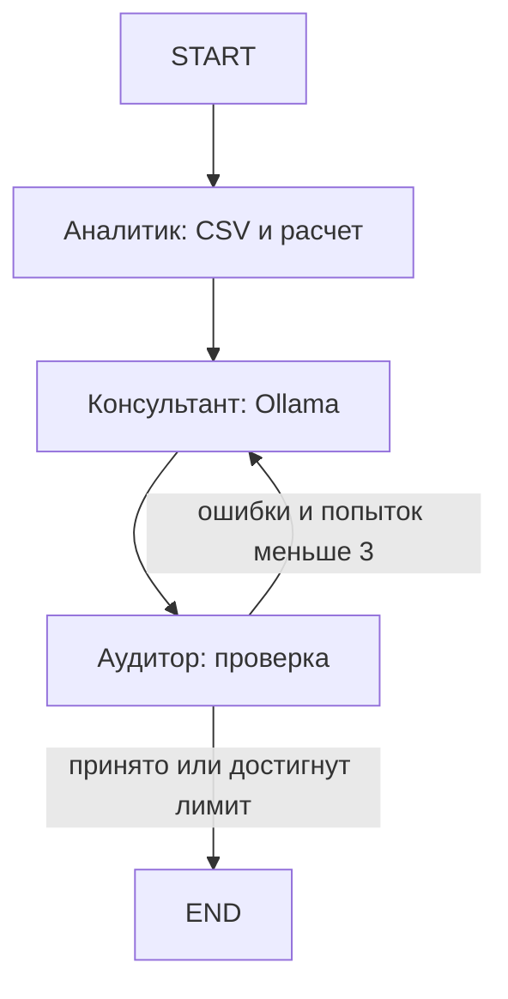

# Sales AI — мультиагентный консультант магазина

## Бизнес-ценность
Проблема: владелец небольшого магазина вручную сводит продажи, себестоимость и остатки, рискуя пропустить убыточные товары и нехватку запасов. Пользователь — управляющий розничной точкой с выгрузкой CSV за неделю. Оценочная гипотеза (не результат опроса): 2 часа на еженедельный отчет при стоимости рабочего часа 700 руб., то есть 1400 руб. Цель — 15 минут и 175 руб. рабочего времени, экономия 87,5% без учета затрат на оборудование и проверку. Проверять гипотезу следует на 10 реальных отчетах, измеряя время до утверждения и долю ошибок в показателях. Дополнительная метрика — доля отчетов, прошедших формальную проверку.

Один агент технически возможен, но отдельные роли дают воспроизводимый расчет, независимую проверку и повторную генерацию без повторного чтения файла. Это не гарантия превосходства над хорошо реализованным одиночным агентом.

## Архитектура

State — TypedDict. Аналитик и аудитор являются детерминированными агентами с независимыми задачами; консультант использует LLM. Инструменты: чтение и валидация CSV, расчет финансовых показателей. В режиме сравнения одиночный агент получает те же рассчитанные данные и тот же промпт, но не получает обратной связи. Аудитор проверяет обе архитектуры одинаковым правилом. Неутвержденный результат обозначается approved=false и CLI завершится кодом 2. Максимум три вызова консультанта; дополнительно задан recursion_limit.

## Запуск
Python 3.10+; установите Ollama с https://ollama.com/ и выполните в терминале:
```bash
ollama pull qwen2.5-coder:7b
# если сервер еще не запущен: ollama serve
python -m venv .venv
# Linux/macOS: source .venv/bin/activate
# Windows PowerShell: .venv\Scripts\Activate.ps1
pip install -r requirements.txt
python app.py data/cafe.csv --output reports/live_cafe.json
python app.py data/electronics.csv --output reports/live_electronics.json
python app.py data/stationery.csv --output reports/live_stationery.json
```
В выводе JSON содержатся оба ответа, метрики, журнал переходов, замечания и число вызовов. Можно передать `--question "Какие товары требуют внимания?"` и `--model llama3.1:8b` (предварительно загрузить модель). CSV — продажи за один одинаковый период, остатки на его конец, целые рубли; profit — валовая прибыль, не чистая. Остаток ниже половины проданных единиц — эвристика, а не прогноз срока дефицита.

## Сценарии
| Вход | Выручка | Валовая прибыль | Риск / ожидаемое действие |
|---|---:|---:|---|
| cafe.csv | 42000 | 18000 | Кофе: проверить поставку |
| electronics.csv | 42000 | 14500 | Кабель: отрицательная маржа, пересмотреть цену/закупку |
| stationery.csv | 17000 | 9400 | Блокнот: проверить поставку |

## Проверенные результаты
Запуск `python -m unittest -v` — 4 теста успешно. В `reports/` сохранены три фактических прогона тестового режима. Команда для воспроизведения: `python app.py data/cafe.csv --offline`. Этот режим выполняет те же функции узлов и маршрутизацию напрямую, но **не использует LangGraph или Ollama**. Синтетическая модель специально ошибается на первой попытке и исправляет ответ после обратной связи. Во всех трех сценариях одиночный ответ не проходит проверку, мультиагентный проходит со второй попытки (0/3 против 3/3, 1 против 2 вызовов на запрос). Это демонстрация механизма исправления, не доказательство качества LLM. В доступной среде отсутствовали LangGraph, Ollama и сетевой доступ для установки. Реальный прогон требуется выполнить локально, результаты не сфабрикованы.

Пример лога: Аналитик -> Консультант -> Аудитор -> Консультант -> Аудитор -> END.

## Ограничения
Формальная проверка контролирует обязательные числовые строки, упоминание рисков и наличие раздела действий; она не гарантирует смысловую правильность всех рекомендаций и не обнаруживает все возможные выдуманные факты. CSV содержит искусственные демонстрационные данные. Модель не отправляет заказы и не меняет цены. Для оценки бизнес-эффекта необходим пилот. Архитектура выбрана самостоятельно в рамках задания.
